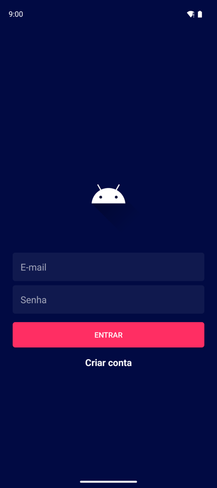
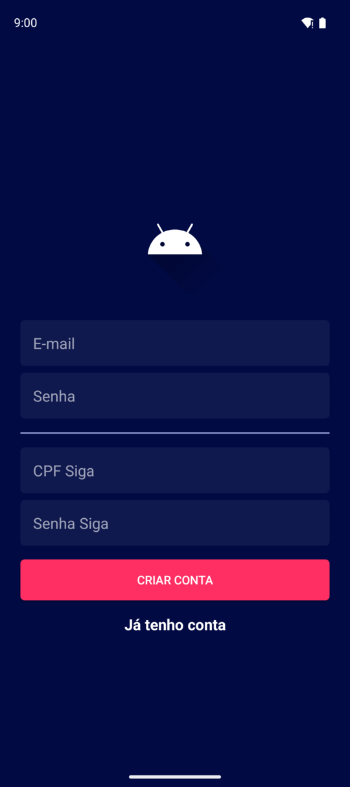
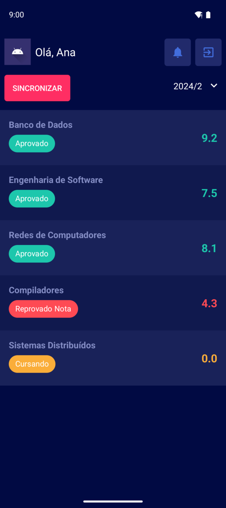
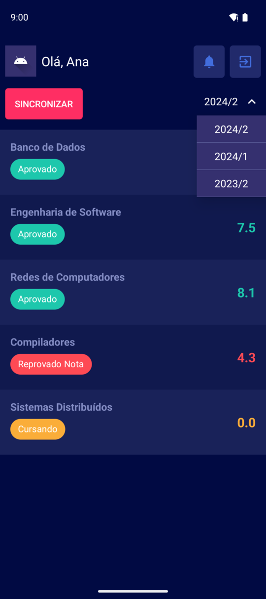

# agis

Android app for [siga-bot](https://github.com/MarioFronza/siga-bot). A student signs up with their [SIGA](https://siga.udesc.br) (UDESC's academic system) credentials, sees their grades for each semester, and gets a push notification when a new grade shows up.

<p>
  
  
  
  
</p>

## Technologies

- Kotlin, Android SDK 23 to 36
- AndroidX (ViewModel, LiveData, ViewBinding)
- Retrofit + Gson, Kotlin coroutines
- OneSignal for push notifications
- JUnit for tests
- Gradle, GitHub Actions

## Installing

Download the APK from the [latest release](https://github.com/MarioFronza/agis/releases/latest) on your phone and open it. Android asks once to allow installs from that source.

## Running

Needs JDK 21 and the Android SDK, or just Android Studio.

By default the app talks to `http://10.0.2.2:8090`, which is the host machine as seen from the emulator, so a local siga-bot on that port works out of the box. Point it somewhere else with `apiUrl`:

```bash
./gradlew installDebug -PapiUrl=https://siga.mariofronza.dev
```

Run the tests:

```bash
./gradlew test
```

## Release

Every push and pull request runs the tests and a debug build. Tagging `vX.Y.Z` also builds a signed APK against production and attaches it to a GitHub release.

```bash
git tag v1.0.0 && git push origin v1.0.0
```

The workflow needs these repository secrets:

| Secret | Description |
| --- | --- |
| `SIGNING_KEYSTORE_BASE64` | release keystore, `base64 -w0 release.jks` |
| `SIGNING_STORE_PASSWORD` / `SIGNING_KEY_PASSWORD` | keystore and key passwords |
| `SIGNING_KEY_ALIAS` | key alias inside the keystore |

Keep a backup of the keystore. Android only installs an update signed with the same key, so losing it means uninstalling the app to get a new version.
